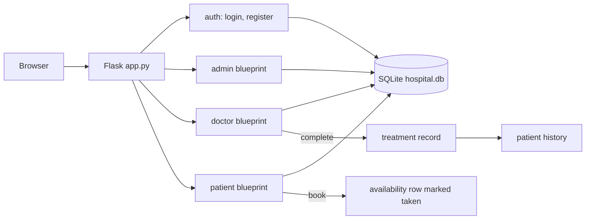

# Hospital Management System (MAD 1)

A server-rendered hospital management web app built with **Flask** and **SQLite** for the IITM BS *Modern Application Development 1* course. An admin manages doctors and patients, doctors publish availability and record treatments, and patients search doctors and book appointments.

**Links:** [GitHub](https://github.com/shriram-s7/HOSPITAL-MANAGEMENT-SYSTEM-MAD-1) · [Demo video](https://youtu.be/ing8-6VmQz0) · Follow-up project: [Hospital Management System (MAD 2)](https://github.com/shriram-s7/HOSPITAL-MANAGEMENT-SYSTEM-MAD-2)

## Overview

The system covers the basic hospital workflow: a pre-created admin onboards doctors; patients self-register, find a doctor by name or department and book a free slot from that doctor's availability; doctors then complete or cancel the appointment and record a diagnosis, prescription and notes, which become part of the patient's history. Everything runs in one Flask process with Jinja2 templates and a single SQLite file. It is a course project (MAD 1), not a production system.

## Features

| Role | Capabilities |
|---|---|
| **Admin** (pre-created) | Dashboard with doctors, patients and upcoming appointments; add doctors; edit doctors and patients; search by name; blacklist users |
| **Doctor** (created by admin) | Add and delete availability slots (date + time slot); see assigned appointments; mark them complete with diagnosis, prescription and notes, or cancel; view a patient's treatment history |
| **Patient** (self-registers) | Register and log in; browse departments and search doctors; book an available slot; cancel; view own treatment history; edit profile |

Other behaviour in the code:
- Blacklisted users cannot log in ("Account disabled/blacklisted").
- Booking marks the chosen availability row as taken, so the same slot cannot be booked twice.
- Duplicate availability slots for a doctor are rejected.
- A small JSON endpoint, `GET /patient/api/doctors`, lists doctors (described in `api.yaml`).

## How it works



Role checks are done per request from the session (`admin_required`, `doctor_required`, `patient_required`). Tables: `users`, `doctors`, `patients`, `appointments`, `treatments`, `availability`, `blacklist`. They are created by `init_db()` at startup, together with the admin account if none exists.

## Tech stack

| Layer | Technology |
|---|---|
| Backend | Python 3, Flask (blueprints) |
| Database | SQLite via the standard `sqlite3` module |
| Templates | Jinja2, one stylesheet in `static/style.css` |
| Security | Werkzeug password hashing, Flask sessions |
| API description | OpenAPI 3 (`api.yaml`) |

## Project structure

```text
app.py        Flask app and blueprint registration
auth.py       login, register, logout
admin.py      dashboard, doctor/patient management, search, blacklist
doctor.py     availability, appointments, treatment records
patient.py    doctor search, booking, history, profile, JSON doctor list
database.py   schema creation, admin seeding, query helpers
utils.py      small helpers
templates/    Jinja2 pages
static/       stylesheet
api.yaml      API description
project_report.pdf   course project report
```

## Getting started

Prerequisites: Python 3.

**Windows (PowerShell)**

```powershell
python -m venv .venv
.\.venv\Scripts\Activate.ps1
pip install Flask
python app.py
```

**Linux / macOS**

```bash
python3 -m venv .venv && source .venv/bin/activate
pip install Flask
python app.py
```

Open http://127.0.0.1:5000/. `hospital.db` is created on first start. There is no `requirements.txt`; Flask brings in Werkzeug and Jinja2.

Environment variable (optional): `FLASK_SECRET` signs session cookies. If unset, a development default from `app.py` is used, so set your own for anything beyond local use. No `.env.example` is needed.

## Usage

1. Log in as the admin. The initial admin username and password are created in `database.py` (`init_db`); change that password before any real use.
2. Add a doctor from the admin dashboard, then log in as that doctor and add availability slots.
3. Register a patient account from the login page, search for the doctor, and book a slot.
4. As the doctor, complete the appointment and enter a diagnosis and prescription; the patient sees it under history.

## Tests

There is no automated test suite in this repository.

## Status and limitations

- Feature-complete for the course brief (admin, doctor and patient flows).
- Runs on the Flask development server with `debug=True`; do not deploy as is.
- The admin account uses a fixed default password defined in source, and the session secret falls back to a development default.
- No CSRF protection or rate limiting.
- The demo video file is kept locally and is not in the repository.

## Credits

Course project for IIT Madras BS, Modern Application Development 1, by S Shriram.

## License

No license specified.
